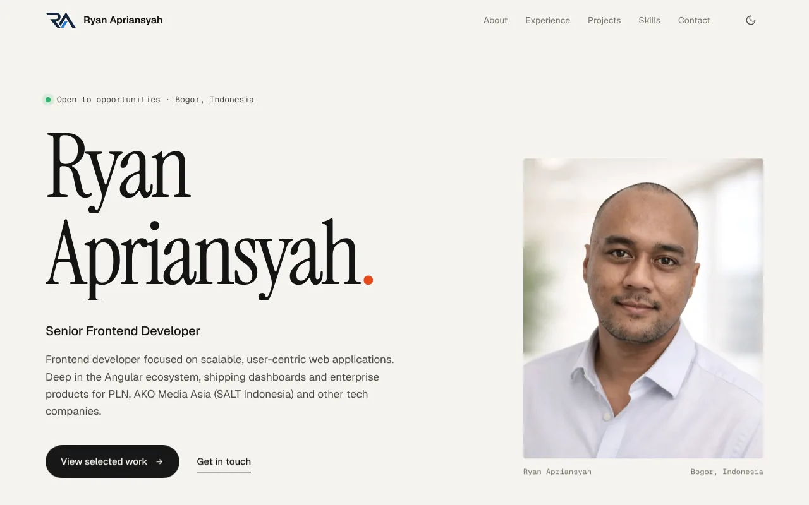

# Ryan Apriansyah — Portfolio

Personal portfolio of Ryan Apriansyah, Senior Frontend Developer based in Bogor, Indonesia.

**Live site:** https://ryugazaki.github.io/my-portofolio/

<picture>
  <source media="(prefers-color-scheme: dark)" srcset="docs/screenshot-dark.webp">
  
</picture>

## Features

- Single-page layout: About, Experience, Projects (filterable), Skills and Contact
- Light and dark theme that follows the system setting, with a manual toggle and no flash on load
- Reveal-on-scroll animations and an active-section indicator in the nav
- Responsive down to phone width, keyboard accessible, respects `prefers-reduced-motion`
- SEO-ready: Open Graph/Twitter preview image, canonical URL, JSON-LD `Person` data and sitemap

## Tech stack

- [Angular 20](https://angular.dev) — standalone component, signals, zoneless change detection
- SCSS with CSS custom properties for theming
- `NgOptimizedImage` for the hero portrait (WebP)
- Karma + Jasmine for unit tests
- GitHub Actions + GitHub Pages for CI and hosting

## Getting started

Requires Node.js 20.19+, 22.12+ or 24+.

```bash
npm ci        # install dependencies
npm start     # dev server at http://localhost:4200
npm run build # production build into dist/my-portofolio/browser
npm test      # unit tests in watch mode
npm run test:ci # unit tests once, headless (used in CI)
```

## Updating content

All content lives in typed data files, so most updates never touch the component:

| File | Content |
| --- | --- |
| `src/app/data/profile.ts` | Name, role, bio, contact details, social links, career start year |
| `src/app/data/experience.ts` | Work experience and education |
| `src/app/data/projects.ts` | Projects and filter categories |
| `src/app/data/skills.ts` | Skill groups and the hero "Stack" line |
| `src/app/data/testimonials.ts` | Testimonials (the section stays hidden while the list is empty) |

Types for every entry are in `src/app/data/models.ts`. A few optional fields render only when filled:

- `Project.highlights` — measurable outcomes, e.g. `'Cut page load time by 40%'`
- `Project.link` — live demo, repository or case study
- `Testimonial.url` — source of the quote, e.g. a LinkedIn recommendation

Static files served as-is (favicon, Open Graph image, sitemap) are in `public/`; images used by the page are in `src/assets/`.

## Project structure

```
src/
├── index.html          # meta tags, Open Graph, JSON-LD, theme bootstrap
├── styles.scss         # design tokens (colors, fonts) and global styles
└── app/
    ├── app.ts          # page component: UI state, theme, scroll behaviour
    ├── app.html        # page template
    ├── app.scss        # page styles
    └── data/           # all portfolio content (see above)
public/                 # favicon, og-image.jpg, sitemap.xml
.github/workflows/      # CI and deploy workflow
```

## Deployment

`.github/workflows/deploy.yml` runs on every pull request and every push to `master`:

1. Install dependencies and run the unit tests
2. Build for production with `--base-href /my-portofolio/`
3. On `master` only, publish `dist/my-portofolio/browser` to the `gh-pages` branch, which GitHub Pages serves

Pull requests get the test and build check without deploying. A deploy can also be started by hand from the **Actions** tab (`workflow_dispatch`).

If the site moves to a custom domain, update the `--base-href` in the workflow and the absolute URLs in `src/index.html` and `public/sitemap.xml`.
